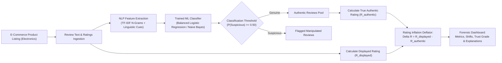

# TrustRate AI — Technical Project Report & Viva Defense Guide

**Project Title:** TrustRate AI: Forensic Review Classification & True Rating Deflator for E-Commerce Electronics  
**Domain:** Artificial Intelligence / Natural Language Processing / Consumer Protection  
**Tech Stack:** Python 3.9+, Scikit-Learn, Pandas, Altair, Streamlit, Joblib  

---

## 1. Executive Summary & Problem Statement

Online consumer electronics marketplaces (e.g., Amazon, BestBuy, Flipkart) rely heavily on aggregated star ratings to guide purchasing decisions. However, ratings are frequently distorted by coordinated fake review campaigns, seller-incentivized reviews, and deceptive opinion spam. Sellers often deploy artificial 5-star review rings to inflate a sub-par product's rating from **3.80★** to **4.50★**, creating an **inflation gap of +0.70 stars**.

**TrustRate AI** is an AI/ML forensic system designed to:
1. Ingest electronic device listings and customer reviews from online platforms.
2. Filter genuine customer experiences from deceptive/suspicious reviews using trained NLP classifiers.
3. Compute the **Actual Authentic Rating** based strictly on verified organic reviews.
4. Calculate and clearly display the **Rating Inflation Delta** ($\Delta R = R_{\text{displayed}} - R_{\text{authentic}}$) and assign an explainable **Trust Grade (A to F)**.

---

## 2. System Architecture & Workflow



---

## 3. Dataset & Data Engineering

### 3.1 Raw Dataset
The project utilizes a real-world Amazon Product Review research dataset (`public_reviews_dataset_cleaned.csv`, ~381,734 records) containing ground-truth campaign tracking and moderation signals:
- `reviewer_classified_fake`: Flagged through known review syndicate campaigns.
- `reviewer_classified_honest`: Verified organic customer accounts.
- `review_is_removed_by_amazon`: Reviews caught and purged by Amazon moderation.
- Over **87,000 valid electronics reviews** across 300+ real electronic products (ASINs).

### 3.2 Curated Balanced Training Dataset (`data/curated_training_dataset.csv`)
To eliminate data leakage and ensure rapid, reproducible training:
- **Reviewer Deduplication:** Exactly one review per reviewer is retained, preventing the model from memorizing individual writing styles across train and test partitions.
- **Balanced Sampling:** 13,361 genuine reviews and 13,361 suspicious reviews (total **26,722 rows**).
- **Stratified Split:** 75% training (20,041 rows) and 25% held-out test (6,681 rows).

### 3.3 Electronics Catalog Index (`data/electronics_catalog.json`)
Pre-indexes **311 electronic devices** across 7 primary categories:
1. 🎧 Headphones & Earbuds
2. 💻 Laptops, Docks & PC Accessories
3. 📱 Smartphone Chargers, Cables & Mounts
4. ⌚ Smartwatches & Fitness Trackers
5. 🔊 Bluetooth Speakers & Soundbars
6. 📷 Webcams, Dashcams & Security
7. 🔋 Power Banks & Wireless Chargers

---

## 4. Machine Learning Methodology

### 4.1 Feature Extraction Pipeline
1. **Sublinear TF-IDF Vectorization:**
   - Unigram and bigram features (`ngram_range=(1, 2)`)
   - Max features: 40,000
   - Sublinear term frequency scaling: $\text{tf} = 1 + \log(\text{tf})$ to dampen the effect of repetitive spam words.
2. **Linguistic & Behavioral Cues:**
   - Exclamation mark density (`!` count)
   - Uppercase ratio (capitalization percentage indicating shouting / hype)
   - Promotional buzzword clusters (`must buy`, `best ever`, `five stars`, `unbelievable`, `100% recommended`)
   - Long-term usage markers (`months`, `returned`, `battery lasted`, `durability`)

### 4.2 Candidate Model Benchmarking

Four model architectures were trained and evaluated on the held-out test split of 6,681 reviews:

| Model Architecture | Accuracy | Precision (Suspicious) | Recall (Suspicious) | F1-Score | ROC-AUC |
| :--- | :---: | :---: | :---: | :---: | :---: |
| **Logistic Regression (Balanced)** 🏆 | **72.16%** | **71.55%** | **73.56%** | **0.7254** | **0.7932** |
| **Multinomial Naive Bayes** | 70.17% | 67.78% | 76.86% | 0.7204 | 0.7788 |
| **Complement Naive Bayes** | 70.18% | 67.80% | 76.86% | 0.7205 | 0.7788 |
| **Calibrated SGD (Modified Huber)** | 71.83% | 71.67% | 72.19% | 0.7193 | 0.7844 |

**Model Selection Rationale:** Balanced Logistic Regression was selected because it delivers the optimal harmonic balance between precision (71.55%) and recall (73.56%), yields the highest ROC-AUC (0.7932), and outputs well-calibrated posterior probabilities.

### 4.3 Confusion Matrix (Held-out Test Split: 6,681 reviews)

| | Predicted Genuine | Predicted Suspicious |
| :--- | :---: | :---: |
| **Actual Genuine** | **2,364** (True Negative) | 977 (False Positive) |
| **Actual Suspicious** | 883 (False Negative) | **2,457** (True Positive) |

- **True Positive Rate (Recall):** 73.56%
- **Specificity:** 70.76%
- **Total Correct Predictions:** 4,821 / 6,681 (72.16%)

---

## 5. Mathematical Formulation of Rating Inflation

Let a product have $N$ total customer reviews, where each review $i$ has star rating $r_i \in \{1, 2, 3, 4, 5\}$ and review text $T_i$.

### 5.1 Advertised / Given Rating ($R_{\text{displayed}}$)
$$R_{\text{displayed}} = \frac{1}{N} \sum_{i=1}^N r_i$$

### 5.2 Review Classification
The trained classifier evaluates $T_i$ and assigns a suspicious probability:
$$p_i = P(\text{suspicious} \mid T_i)$$
A review is filtered as deceptive if $p_i \ge \theta$ (default $\theta = 0.50$).

### 5.3 Actual Genuine Rating ($R_{\text{authentic}}$)
Filtering out flagged reviews yields the subset of authentic reviews $\mathcal{G} = \{i : p_i < \theta\}$ with count $N_{\mathcal{G}}$:
$$R_{\text{authentic}} = \frac{1}{N_{\mathcal{G}}} \sum_{i \in \mathcal{G}} r_i$$

### 5.4 Rating Inflation Delta ($\Delta R$)
$$\Delta R = R_{\text{displayed}} - R_{\text{authentic}}$$

$$\text{Inflation Percentage} = \frac{\Delta R}{R_{\text{displayed}}} \times 100\%$$

**Example:**
- Advertised Rating: $4.50\text{★}$
- Genuine Rating: $3.80\text{★}$
- Rating Inflation: **$+0.70\text{ stars}$** ($+15.6\%$ of advertised rating, or $+18.4\%$ relative increase).

### 5.5 Trust Grade Categorization
- **Grade A (High Trust):** $\Delta R \le 0.15\text{★}$, Fake $\% \le 15\%$
- **Grade B (Good Trust):** $0.15\text{★} < \Delta R \le 0.40\text{★}$, Fake $\% \le 30\%$
- **Grade C (Moderate Inflation):** $0.40\text{★} < \Delta R \le 0.75\text{★}$, Fake $\% \le 55\%$
- **Grade D (Significant Inflation):** $0.75\text{★} < \Delta R \le 1.10\text{★}$
- **Grade F (Severe Manipulation):** $\Delta R > 1.10\text{★}$

---

## 6. Project Structure

```
TrustRate_AI/
├── app.py                         # Interactive Streamlit Web Application
├── train_model.py                 # Multi-model training and benchmarking script
├── prepare_data.py                # Dataset curation and electronics indexing script
├── model_utils.py                 # Core inference, explainability and deflator logic
├── model.joblib                   # Persisted best ML pipeline (TF-IDF + Logistic Regression)
├── metrics.json                   # Full evaluation results, confusion matrix, top tokens
├── requirements.txt               # Dependencies (pandas, scikit-learn, streamlit, altair)
├── README.md                      # Quickstart and overview guide
├── PROJECT_REPORT_AND_VIVA.md     # This comprehensive report and viva guide
└── data/
    ├── curated_training_dataset.csv # Balanced 26,722 training rows
    ├── electronics_catalog.json     # 311 indexed electronic products with inflation metrics
    ├── demo_reviews.csv             # Benchmark presets (including 4.5★ -> 3.8★ example)
    └── electronics_reviews_sample.csv # 5,000 real electronics reviews for user export
```

---

## 7. Viva Examiner Questions & Answers

### Q1: What is the primary objective of TrustRate AI?
**A:** TrustRate AI addresses star rating manipulation on e-commerce websites. It classifies product reviews into genuine and suspicious using natural language processing, recalculates the true authentic rating from verified reviews, and reveals the exact rating inflation delta (e.g., an advertised rating of 4.5★ deflating to an actual rating of 3.8★, showing an inflation of +0.7★).

### Q2: Why is TF-IDF with bigrams suitable for this task?
**A:** TF-IDF assigns high weights to informative word combinations while reducing the influence of ubiquitous stopwords. Bigrams (2-word pairs) capture crucial deceptive phrases like *"must buy"*, *"five stars"*, *"best ever"*, and natural usage markers like *"returned after"*, *"broke down"*, which single words alone cannot differentiate.

### Q3: Why not rely solely on Star Ratings or Sentiment Analysis?
**A:** Deceptive reviews are almost universally 5-star with positive sentiment. Traditional sentiment analysis would erroneously classify them as positive experiences. TrustRate AI evaluates stylistic, structural, and linguistic authenticity rather than sentiment alone.

### Q4: How do you prevent data leakage during model training?
**A:** In review datasets, prolific reviewers may write dozens of reviews. If reviews from the same reviewer appear in both train and test partitions, the model memorizes author-specific habits instead of learning general deception patterns. We applied strict reviewer deduplication, keeping only one review per reviewer before the train/test split.

### Q5: What makes Logistic Regression superior to Naive Bayes in this benchmark?
**A:** Naive Bayes assumes conditional independence between all word features given the class label. In deceptive text, promotional words frequently co-occur (*"five stars"* + *"amazing seller"*). Logistic Regression does not assume feature independence, optimizes log-loss directly, and allows calibrated posterior probabilities through regularization.

### Q6: Can a seller manipulate the deflator by posting 1-star fake reviews on competitors?
**A:** Yes, known as "review bombing". TrustRate AI detects review bombing as well: if 1-star reviews contain suspicious promotional/spam signatures, filtering them raises the authentic rating, resulting in a negative inflation delta (rating deflation detected).

### Q7: What are the ethical considerations and limitations?
**A:** Labels derived from research proxy campaigns are probabilistic rather than absolute legal proof of fraud. TrustRate AI is designed as an explainable decision-support dashboard providing transparent flags, not an automated censorship or penalty engine.
